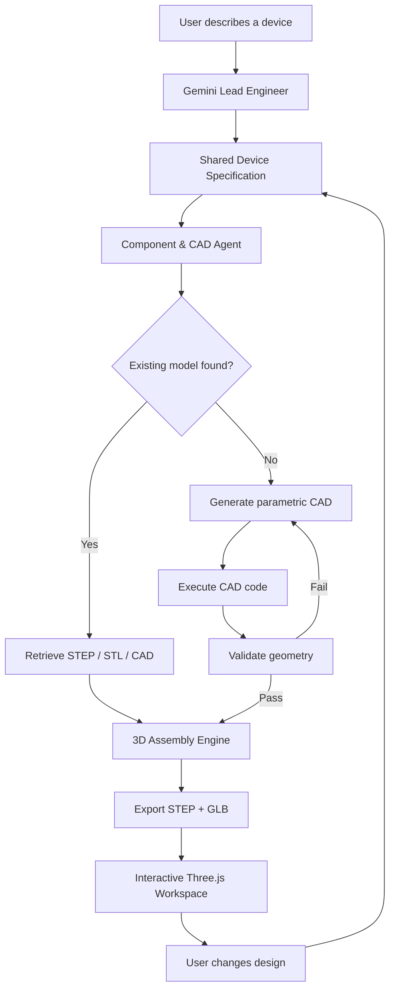

# From research to an editable 3D prototype

## Canonical architecture



Use the shared specification as the editable record. The lead writes requirements and carries forward unresolved questions. The component and CAD stage resolves exact parts, sources, and fidelity. The assembly engine consumes those parts with stable instance IDs. Check imported geometry for SKU, scale, and usable clearances before assembly, just as for generated geometry. A repair attempt uses the validator's findings to regenerate a candidate without overwriting the published revision. Bound automatic retries and surface any unresolved failure in the workspace. The assembly engine exports editable solids as STEP and a browser model as GLB.

The wristband slice implements the parametric branch with fixed, typed geometry generation, clearance checks, GLB export, and dimension edits. Automatic vendor asset discovery and ingestion, STEP export for the assembled wristband, and Gemini-driven geometry retries are follow-on work. The KB2040 is the first exact-asset pilot for the retrieval branch.

## First vertical slice

Run the wristband brief through the research harness, generate a versioned 3D assembly, and open it in a browser. Clicking the controller, sensor, or enclosure opens an inspector for that item. Changing wrist circumference regenerates the strap and updates the scene while keeping the selected part and camera position.

```text
ADK research → ResearchReport → DeviceSpec → mechanical generator → AssemblyManifest
                                                       ↑                    ↓
                                                 validated edit ← Three.js workspace
```

## The data handoffs

| Contract | Producer | Fields the next stage relies on |
| --- | --- | --- |
| `ResearchReport` | Existing ADK research harness | Requirements, catalog snapshot, selected component IDs, findings, sources, and agent events |
| `DeviceSpec` | Server-side adapter | Project ID, revision, selected part instances, catalog snapshot, user constraints, and mechanical parameters |
| `AssemblyManifest` | Deterministic generator | Project ID and revision, units, stable scene node IDs, geometry references, dimensions, transforms, part instance IDs, fidelity, and fit findings |

The adapter consumes a validated report with `review.status == "candidate"`. It verifies each selection against the catalog evidence returned during that run. A blocked or unsupported report shows its findings in the workspace and stops before assembly generation. Missing wrist circumference stays open for user input or an explicit, labeled preview assumption.

Use `catalog_id` to identify a SKU and `instance_id` to identify a placed component. Map CircuitMind's reserved board endpoint to `board` and use IDs such as `sensor-1` for other components. A single part can have several scene meshes with one shared `part_instance_id`. Give the enclosure, lid, and strap their own stable scene IDs, since they have editable parameters and no electronics SKU. These IDs drive selection across the scene, parts list, and eventual circuit view.

## How the model is generated

1. Store part footprints, heights, and connector clearance in a mechanical catalog keyed by SKU. Record the source and distinguish measured values from assumptions. Start with the published ESP32-DevKitC V4 and MyoWare 2 footprints. [Espressif board drawing](https://dl.espressif.com/dl/schematics/esp32_devkitc_v4_dimensions.pdf) · [SparkFun sensor dimensions](https://cdn.sparkfun.com/assets/learn_tutorials/1/9/5/6/MyoWare_v2_Muscle_Sensor_Board_Dimensions.png)
2. Add a Gemini mechanical stage to the existing ADK graph. Give it a local Python tool such as `generate_enclosure(wrist_circumference_mm, wall_mm, clearance_mm)`. The harness supplies the project revision and selected parts. The same generator runs from the offline fixture and when a user edits dimensions in the UI. [ADK agent tools](https://adk.dev/agents/llm-agents/)
3. Keep the first generator small. It produces board proxies, enclosure walls and lid, and a strap sized from the wrist parameter. It checks finite dimensions, part overlap, and clearance around connectors. If the combined footprint cannot fit, return the fit finding so the user can adjust dimensions or choose a split layout later.
4. Render assembly JSON as Three.js primitives in the MVP. The manifest and input parameters support regeneration. Load licensed GLB assets per SKU when available and export GLB for sharing. Convert millimeters to meters at the glTF boundary. Add CadQuery when STEP solids are required. [Three.js GLTFLoader](https://threejs.org/docs/pages/GLTFLoader.html) · [glTF coordinate system and units](https://registry.khronos.org/glTF/specs/2.0/glTF-2.0.html#coordinate-system-and-units) · [CadQuery export formats](https://cadquery.readthedocs.io/en/latest/importexport.html)

The virtual demo can generate the enclosure and board proxies from these measurements with the existing Python toolchain. Detailed vendor geometry, snap and header height measurements, and 3D CAD software can wait until the team needs exact fit or printable exports.

### Pilot the asset pipeline with Adafruit #5302

Resolve the product URL to the exact Adafruit SKU and KB2040 board revision. The board's downloads page links to EagleCAD source, schematic and fabrication drawings, pinout artwork, and vendor CAD. The CAD directory contains STEP, STL, 3MF, and Fusion files. The 615-page Raspberry Pi datasheet describes the RP2040 chip. Use it for package and electrical facts, and preserve PDF page references when recording them. Use Adafruit's board files for board geometry and signal mapping. [KB2040 product](https://www.adafruit.com/product/5302) · [Board downloads](https://learn.adafruit.com/adafruit-kb2040/downloads) · [Vendor CAD](https://github.com/adafruit/Adafruit_CAD_Parts/tree/main/5302%20KB2040) · [RP2040 datasheet](https://pip-assets.raspberrypi.com/categories/814-rp2040/documents/RP-008371-DS-2-rp2040-datasheet.pdf)

1. **Discover and record evidence.** Resolve manufacturer, SKU, and revision. Store source URLs, file hashes and licenses, then extract typed dimensions, visible parts, ports, and pin references with source locations.
2. **Use the highest-fidelity geometry available.** Import vendor STEP first and keep it as the dimensional source. When STEP is absent, derive the board outline, drill features, and component placements from EDA files. Build mechanical parts from reusable footprints and component geometry.
3. **Use vision to fill visual gaps.** Compare top, bottom, and side photos against known dimensions. Estimate the outline or part placements when stronger sources are absent. Use photos for materials, markings, and visual comparison. Tag hidden geometry, heights, and uncertain placement as estimated.
4. **Export a modular asset.** Tessellate the assembly into GLB with node IDs for the board and inspectable features where available. Keep the editable assembly manifest alongside it. Compare bounding dimensions, USB connector opening, and pin origins to drawings before allowing any fit claim.

The KB2040 pilot converts the official STEP file to a Y-up GLB with 41 named nodes. See the [conversion and provenance notes](kb2040-asset.md) for the source, dimensions, and reproduction command. The current research harness uses a curated EMG catalog. Automatic CAD ingestion and computer vision are planned.

## Wire the harness to the workspace

Keep the existing Python package headless and expose it through a small local JSON API once the fixture works. The Next.js server calls that API and the browser renders its output. Land the first viewer as a Prototype tab in the CircuitMind-derived workspace, alongside the existing electrical views.

- **Create a project.** Submit the brief and either run Gemini or request the explicit offline fixture. Return the report, current spec, and first manifest when generation succeeds. Show the research findings when generation is blocked.
- **Apply an edit.** Send `base_revision` with a typed parameter patch. Validate and build the replacement assembly before publishing the next revision. Reject stale edits with HTTP 409 and keep the last good assembly visible when regeneration fails.
- **Update the viewer.** Swap the scene to the new manifest and preserve camera and selection for any surviving IDs. Changing wrist size runs the generator directly. Changing the selected board or a budget that affects selection reruns the relevant research checks before rebuilding.

A fixture-generated manifest is the first frontend dependency. Build and test selection and edit behavior against it before connecting the browser to a live model. Store the spec and manifest at the same published revision so the inspector never displays part data from a different design.

## Three.js workspace

- **Left panel.** Searchable parts list and editable dimensions. Each part is a focusable control with the same selection behavior as its 3D mesh.
- **Center viewport.** React Three Fiber over Three.js with orbit, zoom, reset, and an enclosure hide or explode control. Pointer picking resolves the nearest selectable object to a stable ID. Ignore camera drags and stop propagation at the selected object. [React Three Fiber pointer events](https://r3f.docs.pmnd.rs/api/events) · [Three.js Raycaster](https://threejs.org/docs/pages/Raycaster.html)
- **Right inspector.** Show the selected part's SKU, sources, dimensions, and fit notes. For an enclosure node, show its parameters and regeneration status. Provide a parts-list inspector if WebGL is unavailable.
- **Visual direction.** Graphite canvas, frosted charcoal panels, white type, thin borders, and restrained highlights. Keep glass effects on the panels and give the selected component a strong outline. Show generation and fit status with text or icons so the interface works in monochrome.

## Acceptance checks

- An offline research run generates the two selected board proxies and an enclosure, and each appears as an inspectable item.
- Selecting the MyoWare mesh highlights the same part in the list and displays the exact SKU and its evidence. Keyboard selection produces the same result.
- A wrist edit from 160 mm to 185 mm changes the strap geometry, increments the revision, and preserves the selected component.
- Reapplying an edit against the old revision returns 409. An invalid clearance shows a finding and leaves the last good assembly available.
- Missing geometric data is labeled as an assumption or a fit blocker. The workspace can still show the research report.
